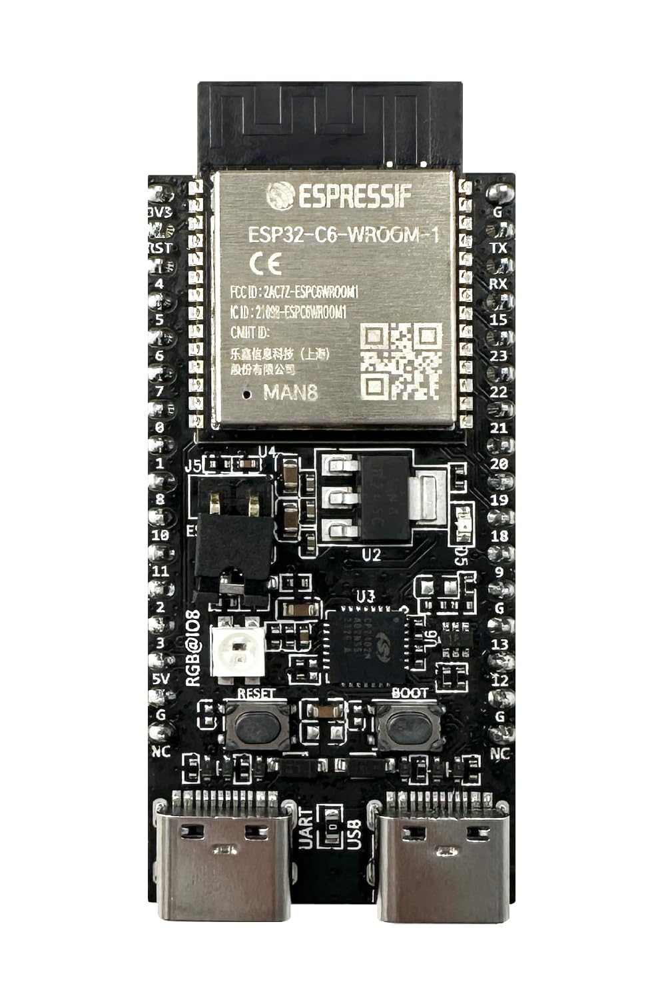
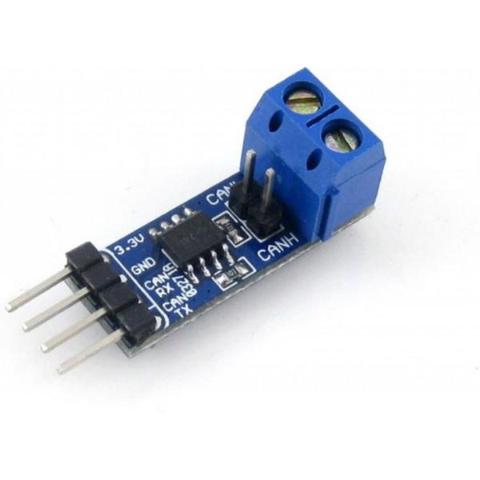
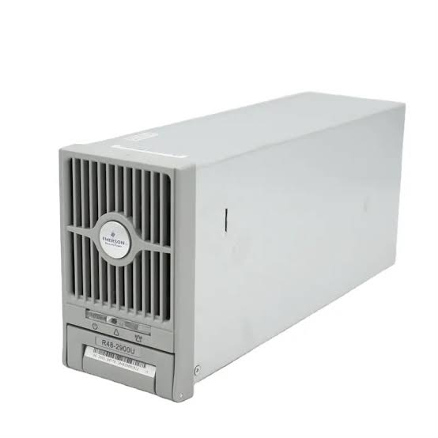
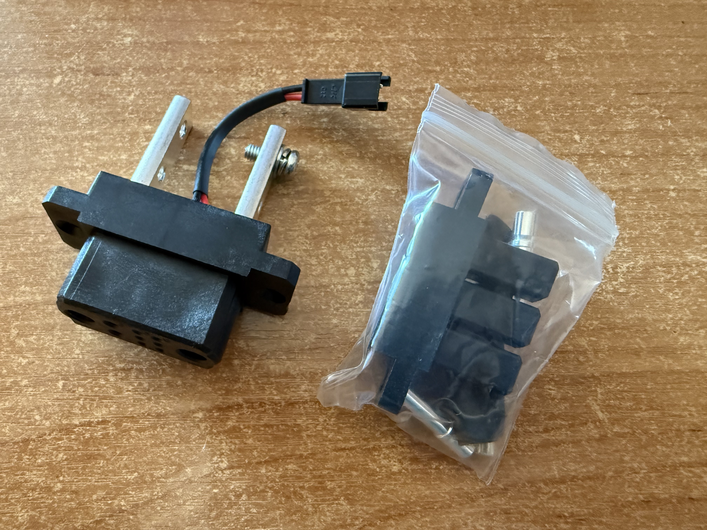

# esphome-emerson-r48

Контроллер ESPHome для б/у выпрямителей Emerson/Vertiv серии R48 (R48-2900U, R48-2000 и аналоги). Один ESP32 ведёт 1–3 модуля по расширенной шине CAN 125 кбит/с. Частый сценарий — зарядка сборки LiFePO4 на 48 В.

**[English version](README.md)**

## Возможности

- Индивидуальное управление напряжением и током каждого блока
- Мониторинг в реальном времени (выходное напряжение/ток, входное напряжение, температура, мощность, % загрузки)
- Флаги ошибок и статусов (перегрев, отказ вентилятора, ограничение по сети, общая ошибка)
- Управление вентилятором
- Балансировка лимита тока по входному напряжению каждого модуля
- Виртуальный лимит суммарной мощности
- Общее задание напряжения на все модули
- Автоматическое обнаружение модулей (выводит Heartbeat / Response / Command ID)
- Ручной сброс CAN (кнопка CAN Hard Reset переустанавливает драйвер TWAI; автоматического восстановления нет)
- Поддержка 1–3 модулей

## Оборудование

- Любой ESP32 (ESP32, ESP32-C3, ESP32-C6, ESP32-S3 и т.д.)
- CAN-трансивер SN65HVD230 (или совместимый)
- 1–3 выпрямителя Emerson/Vertiv R48 (например R48-2900U)

Скорость CAN задана в `packages/can_bus.yaml`: **125 кбит/с**, extended frames. Модули R48 работают на ней. Менять не нужно.

<p align="center">
  
  
  
  
</p>

<p align="center">
  <em>ESP32-C6 · SN65HVD230 · Emerson R48-2900U</em>
</p>

### Подключение

| ESP32     | SN65HVD230 | Emerson R48      |
|-----------|------------|------------------|
| TX пин    | TXD        | —                |
| RX пин    | RXD        | —                |
| 3.3V      | VCC        | —                |
| GND       | GND        | —                |
| —         | CANH       | Пин 9 (CANH)     |
| —         | CANL       | Пин 6 (CANL)     |

Рекомендуемая топология (линейная шина с терминаторами):

```
ESP + 120Ω ────── БП1 ────── БП2 ────── БП3 + 120Ω
```

Избегайте топологии «звезда». Проверьте сопротивление между CANH и CANL (при выключенном питании):
- ~60 Ом → два терминатора (хорошо)
- ~120 Ом → один терминатор
- высокое сопротивление → терминаторов нет

## Быстрый старт

1. Возьмите пример из `examples/emersonscontrol.yaml` или подключите пакеты удалённо из этого репозитория.
2. Укажите пины CAN в substitutions (`can_tx_pin`, `can_rx_pin`) **только числами** (не `GPIO6`).
3. Лучше не использовать strapping-пины (на ESP32-C6 по возможности избегайте GPIO4/GPIO5).
4. Прошейте устройство один раз и откройте логи.
5. Нажмите кнопку **Show Detected Modules**.
6. Скопируйте появившиеся Heartbeat / Response / Command ID в substitutions.
7. Перепрошейте.

Пример substitutions:

```yaml
substitutions:
  # Только номер GPIO (нужно для CAN Hard Reset / TWAI reinstall)
  can_tx_pin: "6"
  can_rx_pin: "10"

  psu1_command_id: "0x06080783"
  psu1_response_id: "0x060F8007"

  psu2_command_id: "0x06080F83"
  psu2_response_id: "0x060F800F"

  psu3_command_id: "0x06081783"
  psu3_response_id: "0x060F8017"
```

## Балансировка

Каждый цикл пакет сравнивает живой модуль с самым высоким входным напряжением. Внутри мёртвой зоны лимит тока может шагнуть вверх. За её краем лимит снижается, полный `balance_step` достигается при просадке 13 В. Просевшей фазе остаток бюджета не отдаётся.

Равные ватты на трёх фазах это не держит. Режется модуль, у которого сеть ниже лучшей фазы. Если измеренный выходной ток уже ниже лимита, этот цикл модуль не рулит.

Параметры (задаются в YAML устройства):

| Параметр               | Описание                                              | Пример  |
|------------------------|-------------------------------------------------------|---------|
| `balance_deadband`     | Вольты ниже лучшей фазы, после которых лимит режется  | `"2.0"` |
| `balance_step`         | Максимальное изменение лимита за цикл, амперы         | `"2.5"` |
| `balance_send_delta`   | Не писать в CAN, если изменение меньше, амперы        | `"0.5"` |
| `balance_min_current`  | Минимальный токовый лимит на модуль                   | `"2.0"` |
| `balance_max_current`  | Максимальный токовый лимит на модуль                  | `"55.0"`|
| `balance_interval`     | Как часто выполняется балансировка                    | `"3s"`  |

Включение/выключение балансировки — переключателем **Balancing Enable**.

Также доступны:
- **Total Power Limit** — виртуальный потолок суммарной мощности
- **All PSUs Set Voltage** — задаёт одинаковое напряжение на все модули

## Пакеты

| Файл                      | Назначение                                          |
|---------------------------|-----------------------------------------------------|
| `packages/can_bus.yaml`   | CAN-интерфейс + обнаружение модулей + разбор статусов |
| `packages/psu.yaml`       | Шаблон одного выпрямителя                           |
| `packages/common.yaml`    | Опрос, Hard Reset, Show Detected Modules            |
| `packages/balancing.yaml` | Балансировка по фазам + общие органы управления     |

## Благодарности

Проект стал возможен благодаря работе многих людей в сообществе:

- Авторам и участникам реверс-инжиниринга CAN-протокола Emerson/Vertiv R48 (сообщества Endless Sphere и другие DIY power electronics группы)
- [syssi/esphome-jk-bms](https://github.com/syssi/esphome-jk-bms) — отличный пример чистой пакетной архитектуры для нескольких устройств в ESPHome
- Проекту ESPHome и его контрибьюторам

## Отказ от ответственности

Это неофициальный community-проект. Используйте на свой страх и риск. Авторы не связаны с Emerson, Vertiv или ESPHome.
